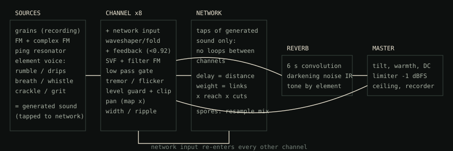

# Harvest

**An 8-channel mycelial sound system.** You start from one or more recordings, or from a generated nature seed, and the system grows them on its own into textures and soundscapes. All eight channels form one network, like mycelium: each channel hears the others, triggers their pings, and grafts fragments of the shared output back into its own sound.

Built with the Web Audio API and an AudioWorklet engine. Runs in any current desktop browser, with no build step and no dependencies.



---

## Run it

```bash
git clone https://github.com/<you>/harvest.git
cd harvest
python3 -m http.server 8080        # or: npm run dev
# open http://localhost:8080
```

The page has to be served over `http(s)`. Browsers refuse to load AudioWorklets from `file://`.

### Deploy to GitHub Pages
Push to `main`. The workflow in `.github/workflows/pages.yml` publishes the repository root. Turn it on once under **Settings → Pages → Source: GitHub Actions**.

### Single-file build
```bash
npm run build      # → dist/harvest.html (self-contained) and dist/artifact.html (for claude.ai artifacts)
```

### Stress test the engine
```bash
npm test           # runs js/engine.js offline with every control at max, at zero, randomised, and with max resonance + feedback
```

---

## How it works

### One system, eight channels
Each channel is a full voice:

| Stage | What it does |
|---|---|
| **Grain** | Cuts grains from the channel's recording: density, size, pitch, scatter. A scan head moves through the sound. |
| **FM** | Carrier, modulator and a second modulator (complex FM). The recording can cross-modulate the carrier. |
| **Pulse** | Pings strike a resonator and open a vactrol-style low pass gate. A melodic walk picks a note from the scale on each ping. |
| **Tone** | Waveshaper/wavefolder, then a zero-delay state-variable filter with audio-rate filter FM. |
| **Space** | Feedback delay through the filter, stereo width, pan motion. |

### Elements: each one is its own instrument
Every channel is Earth, Water, Air or Fire. An element sets the channel's character and adds four controls of its own. Each channel keeps separate settings per element, so switching back restores them.

| Element | Character | Own controls |
|---|---|---|
| **Earth** | low octave, long slow grains, warm, long echoes | Rumble (sub body), Weight (grains drop up to an octave), Tremor, Grit (sample-and-hold + bit reduction) |
| **Water** | high octave, resonant pings, band-pass, moving pan | Drips (rising drop tones), Ripple (modulated delay), Depth (band-pass ↔ low-pass), Flow (grain stream speed) |
| **Air** | long airy grains, bright and wide | Breath (tuned noise), Whistle (comb resonator on the note), Gust (random swells), Shimmer (octave-up grains) |
| **Fire** | short grains, wavefolding, crackle | Crackle, Fold, Flicker (fast random gating), Heat (FM depth + brightness) |

The **element pad** in the System panel pulls the whole system toward one element at once.

### The map
The map has no centre: it is the system's body.
- **Position matters.** A node's x position is its pan. The distance between two nodes sets the delay between them and how strongly they connect (**Reach** sets how far a link carries).
- **Tools:** MOVE (drag nodes), LINK (drag node → node to grow a hypha), CUT (click or swipe across lines). Scroll over a line to make it stronger or weaker.
- **Shapes:** spiral, ring, grid, clusters, river, scatter. **RESHAPE** gives the system a completely new body with new link strengths and random cuts.
- **FREEZE LINKS** stops the links from growing and fading on their own, so your edits stay put.

### Growth and change
- **Life:** a channel with no sound comes alive from what it hears through the network.
- **Spores:** the system samples its own recent output and plants it in empty channels or grafts it into existing sounds.
- **Evolve:** every setting wobbles around its knob position. The glowing dot on each knob shows where it is right now.
- **Dynamics:** channels swell, rest and come back.
- **Mutation:** the system occasionally rewrites a channel's settings (you see the knobs move), and sometimes a channel changes element.
- **SEED:** loads a new random preset with new generated nature sounds (rain on slate, mountain stream, wind in reeds, embers, struck stones, glass and ice, distant thunder), new elements and settings, a new map shape and a new key. Recordings you loaded yourself are kept. Every page load starts from a fresh seed.

### Reverb
A 6-second convolution reverb built from noise that darkens as it decays. Air brightens it and Earth darkens it.

### Store, player and files
- **RECORD** captures the master output as 24-bit WAV into the store, which lives in the browser's IndexedDB.
- The **player** shows the selected take's full waveform. Click or drag to jump, skip ±5 s, and use the keys K / J / L.
- **SAVE** / **SAVE WAV** downloads a take. **EXPORT ALL** saves a zip of every take plus `harvest-manifest.json`, which records each take's settings.
- **SAVE SOUND** on a channel exports its current sound, including everything spores have grafted into it.
- **→ CH** loads a take back into the selected channel, so it becomes new material for the system. **RECALL** restores the settings a take was recorded with.

Inside a claude.ai artifact, files go through the platform's save dialog, and WAVs arrive zipped because the dialog doesn't accept `.wav` directly. Everywhere else they are normal browser downloads.

---

## Stability by design
- **No loops between channels.** Channels hear each other only through the sound each one *generates* (the network taps are written before the network input is added), so no signal can circulate between channels.
- **Feedback stays below unity.** The feedback gain is divided by the filter's resonance peak, so the loop gain stays under 0.92 at any resonance.
- **Ping cascades die out.** A ping can trigger at most one neighbour, with probability ≤ 0.6.
- **Per-channel level guard.** Each channel has a peak-following level guard and a soft clipper.
- **Master ceiling.** The master has a look-ahead limiter at −1 dBFS and a hard ceiling at 0.98.
- **Self-reset.** A NaN or Inf anywhere resets all state and fades back in.
- **CALM** clears every feedback, echo and reverb tail on demand.

`npm test` checks all of this offline.

---

## Keys
| Key | Action |
|---|---|
| Space | grow / pause |
| N | new seed |
| R | record |
| 1–8 | select channel |
| M | mute selected channel |
| K / J / L | player: play-pause / −5 s / +5 s |

Knobs: drag up and down, hold Shift for fine control, double-click to reset, or use the mouse wheel and arrow keys.

---

## Files
```
index.html                 page markup
css/harvest.css            all styles (design tokens at the top)
js/app.js                  UI, state, map, presets, seed generators, store, player, export
js/engine.js               AudioWorklet: harvest-engine (8 channels) + harvest-master (EQ, limiter, recorder)
tools/build-standalone.mjs single-file build → dist/
tools/stress-test.mjs      offline engine stress test
docs/signal-flow.svg       diagram
```

## Browser support
Current Chrome, Edge, Firefox and Safari (AudioWorklet required). Desktop recommended. The interface works on a phone, but the engine is CPU-heavy.

## License
MIT © 2026 Daniel Bovolon. See [LICENSE](LICENSE).
